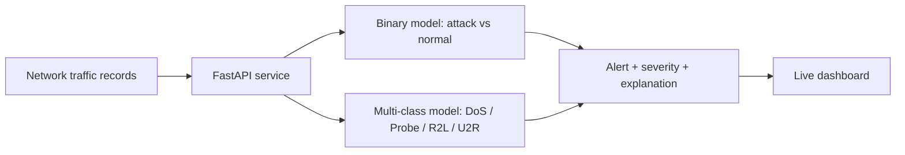

# CyberShield AI

Real-time network threat detection with a live monitoring dashboard.
An XGBoost detector scores network connections, a FastAPI service exposes it,
and a browser dashboard shows alerts, severity, and plain-English explanations.

## How it works



- **Binary model** decides whether a connection is malicious (threshold 0.1).
- **Multi-class model** guesses the attack category. If the binary model flags
  a connection but the category model says "normal", it is shown as `Unclassified`.
- Each alert gets a severity level and a recommended action.

## Results (NSL-KDD, KDDTest+)

| Model | Accuracy | Notes |
|---|---|---|
| Random Forest (baseline, 5-class) | 75% | R2L recall 0.02 |
| XGBoost (5-class, class-weighted) | 78% | DoS F1 0.90, Probe F1 0.75 |
| XGBoost (binary) | 79% | Attack precision 0.97, recall 0.65 |

At the 0.1 threshold, attack recall is 0.68 with a 3% false-alarm rate.

**Known limitation:** KDDTest+ deliberately contains attack variants that never
appear in training, so rare classes (R2L, U2R) are hard to detect. Lowering the
threshold barely helps because missed attacks receive near-zero attack
probability. The dashboard shows missed attacks openly instead of hiding them.

## Run it

```bash
python -m venv venv
source venv/Scripts/activate        # Windows Git Bash
pip install -r requirements.txt

mkdir -p data models
curl -L "https://raw.githubusercontent.com/defcom17/NSL_KDD/master/KDDTrain%2B.txt" -o "data/KDDTrain+.txt"
curl -L "https://raw.githubusercontent.com/defcom17/NSL_KDD/master/KDDTest%2B.txt" -o "data/KDDTest+.txt"
python src/train.py                 # baseline
python src/train_xgb.py             # trains and saves both XGBoost models
uvicorn api:app --app-dir src --reload
```

Open http://127.0.0.1:8000/ for the dashboard and /docs for the API.

## API

| Endpoint | Purpose |
|---|---|
| `GET /health` | Service status and threshold |
| `POST /predict` | Score one connection record |
| `POST /predict-batch` | Score a list of records |
| `GET /simulate?n=5` | Replay random real test traffic |
| `GET /simulate-attack?n=10` | Replay only real attacks (demo button) |
| `GET /alerts` | Recent alerts |
| `GET /stats` | Totals and alerts by category |

## Tech

Python, scikit-learn, XGBoost, FastAPI, vanilla HTML/JS dashboard.